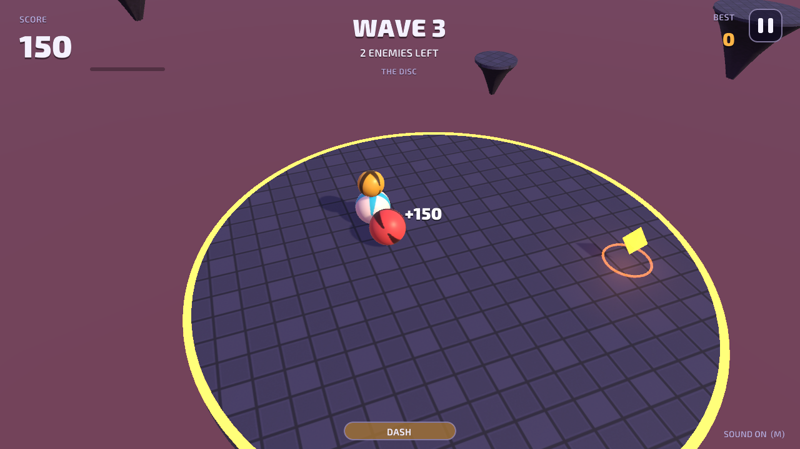
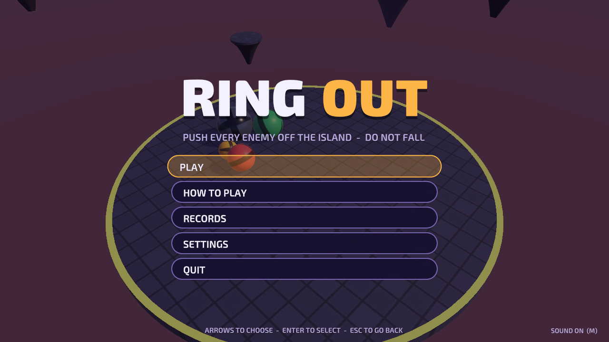
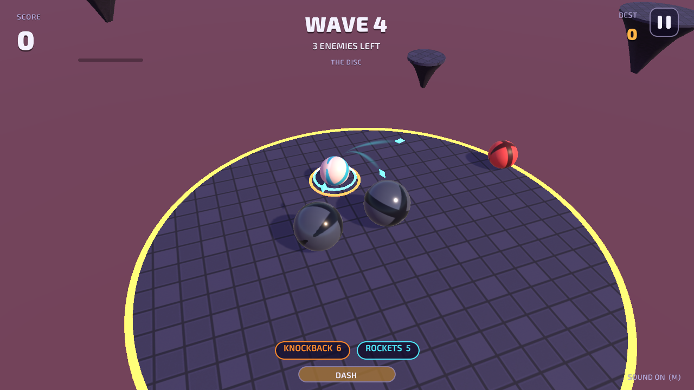
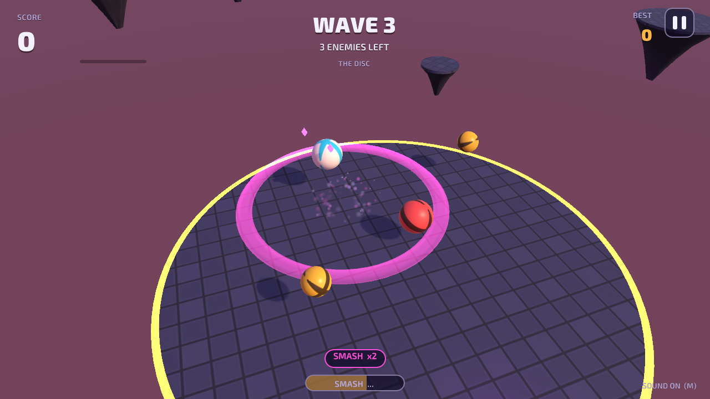
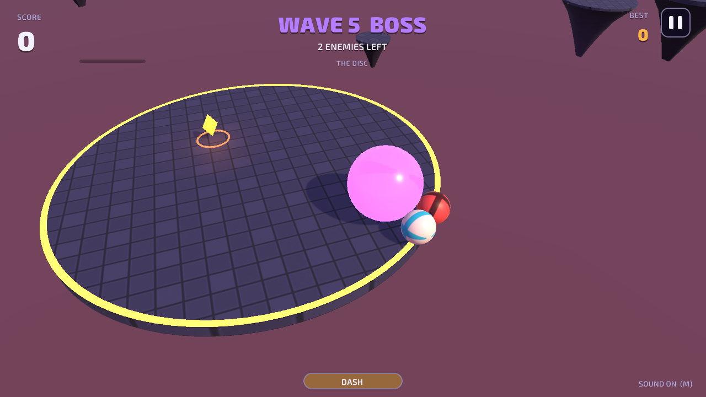
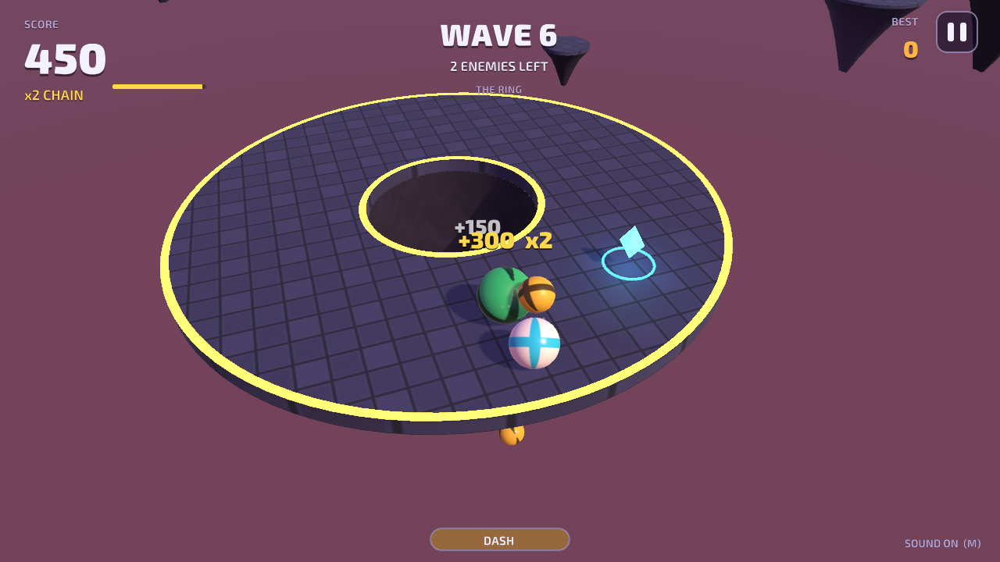
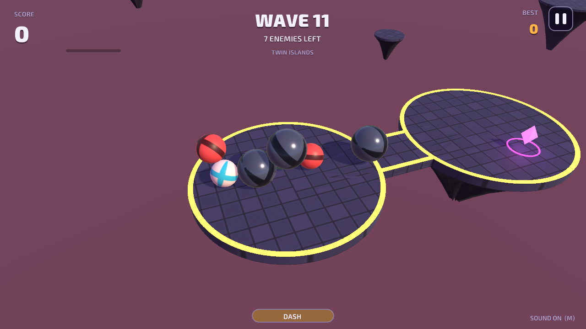
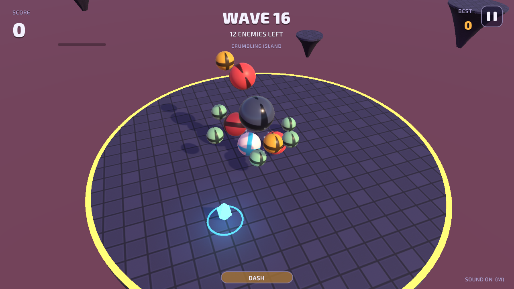
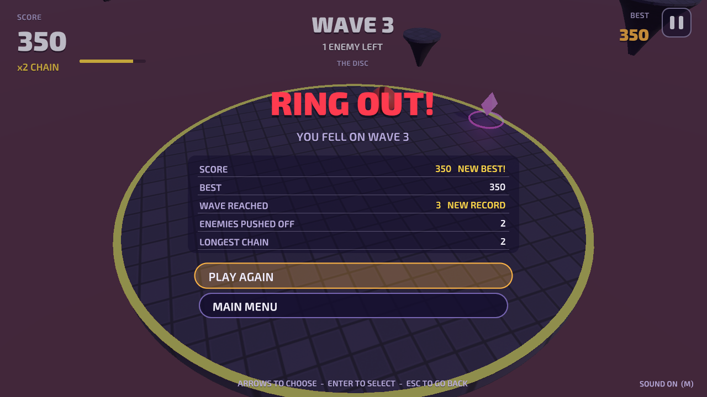
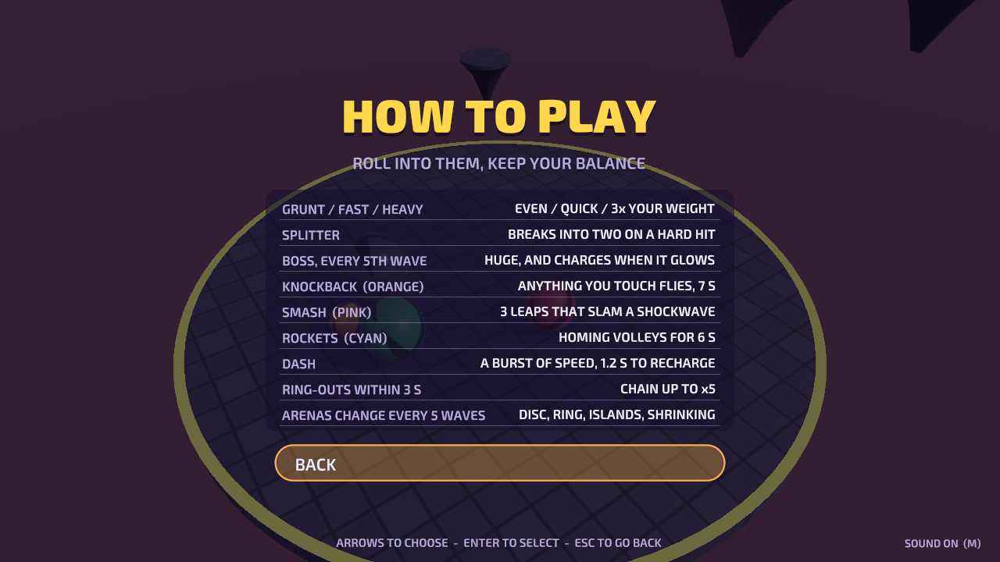

# Ring Out

A physics sumo arena game built with Unity: roll your ball into the enemies and push every one
of them off a floating island before they push you off. Waves grow and bring fast, heavy and
splitting enemies and a boss every fifth wave; three power-ups, a dash and four arenas (a disc,
a ring with a hole, twin islands and an island that crumbles while you fight) keep it moving.
Plays with a keyboard, a gamepad or a touch screen.

It started in 2021 as my take on **Prototype 4 from Unit 4 ("Gameplay Mechanics") of the Unity
Learn Junior Programmer pathway**, and was rebuilt on that idea as an original game (see
[Where it came from](#where-it-came-from)).



| | |
|---|---|
|  |  |
|  |  |
|  |  |
|  |  |
|  | |

## Run it

1. Install **Unity 6000.3.27f1 (Unity 6 LTS)** with Unity Hub (add the Windows or Web build
   support module if you want to build players).
2. In Unity Hub choose **Add → Add project from disk** and select the repository folder.
3. Open `Assets/Scenes/Main.unity` and press **Play**.

To build a player use **File → Build Profiles** (Windows or Web), or build from a terminal into
a folder outside the repository:

```bash
Unity -batchmode -quit -projectPath . -executeMethod RingOut.EditorTools.ProjectBuilder.BuildWebGL -buildOutput ../build/web
```

(`BuildWindows` works the same way.) The WebGL build is uncompressed, so it runs from any
static host such as GitHub Pages.

The tests run from **Window → General → Test Runner** (EditMode and PlayMode), or from a terminal:

```bash
Unity -batchmode -projectPath . -runTests -testPlatform EditMode -testResults results.xml
Unity -batchmode -projectPath . -runTests -testPlatform PlayMode -testResults playmode.xml
```

The scene, materials, textures, physics materials, sky, font atlases, icon and player settings
are generated by **Ring Out → Regenerate Art, Scene and Player Settings**
(`ProjectBuilder.SetUpProject`), and the sounds by `python tools/audio/build.py` (needs
ffmpeg). The README screenshots come from an opt-in hook: run a built player with
`-screenshot <folder>` (optionally `-scenario title,play,powers,...`), or, without a player,
`Unity -batchmode -projectPath . -executeMethod RingOut.EditorTools.ProjectBuilder.CaptureScreenshots -screenshot <folder>`.

## Controls

| Action | Keyboard | Gamepad | Touch |
|---|---|---|---|
| Roll | WASD or arrows (relative to the camera) | Left stick or d-pad | Drag on the left half of the screen |
| Turn the camera | Q / E | Right stick or the shoulder buttons | — (the camera follows you) |
| Dash, or smash while charged | Space, Left Shift or J | A, X or the right trigger | Tap on the right half |
| Pause | Esc or P | Start | The ❚❚ button at the top right |
| Menus | ↑ / ↓ to choose, ← / → to change a value, Enter to select, Esc to go back; or click a row | D-pad or stick, A to select, B to go back | Tap a row |
| Mute | M | Settings → Sound | Settings → Sound |

## How it plays

- **Ring-outs.** Every enemy that falls off scores its worth (grunt 100, fast and splitter 150,
  heavy 250, mini 50, boss 1000). Ring-outs within 3 seconds of each other chain, and the chain
  multiplies the points up to x5. Clearing a wave adds 50 per wave number plus 10 for every
  second under 30. You have one life: fall off and the run is over.
- **Enemies.** Grunts are an even match. Fast enemies are small and light. Heavies weigh three
  times your ball. Splitters break into two minis the first time they are hit hard. Every fifth
  wave is a boss with escorts; it glows as it winds up and charges every four seconds. The chase
  force grows 3% a wave up to wave 13.
- **Waves.** 1, 2, 3, 3, 4, 4, 5 ... up to nine enemies. Fast enemies join on wave 3, heavies on
  4 and splitters on 6, each guaranteed the first time; the rest of the mix is drawn from a
  seeded generator. Every five waves the arena changes: the disc, the ring, the twin islands,
  then the crumbling island, whose edge recedes 12 cm a second down to half its size.
- **Power-ups.** One waits on the island at a time. Knockback (orange) makes everything you touch
  fly for 7 seconds. Smash (pink) gives three charges: the action button leaps and slams a
  shockwave that is strongest under you and fades out at 7 m. Rockets (cyan) fire a volley of
  homing rockets at the nearest enemies every second for 6 seconds. Without a smash charge the
  action button dashes, with 1.2 seconds to recharge.
- **Records** on the device (PlayerPrefs): best score, best wave, longest chain, enemies pushed
  off and runs played. The settings (volume, sound, screen shake, camera turn speed and touch
  controls) are saved too.

## What I learned / technically interesting

- **Rules without the engine.** Waves, enemy stats, power-up timers, the dash cooldown, the
  impulse maths, the arena shapes and spawn placement, scoring and records live in
  `Assets/Scripts/Core`, a plain C# assembly with no Unity references, covered by 74
  deterministic EditMode tests: a seeded xorshift generator makes every run repeatable, and the
  tests check things like "500 spawns on every arena land on the floor and away from the player"
  and "the enemy mix follows its weights over 2,000 waves". 9 PlayMode tests drive the real
  scene: title, start, falling off, clearing a wave, pause, restart, knockback, a smash
  splitting a splitter, and settings.
- **Bugs found with tests first.** In the 2021 prototype a second power-up picked up while one
  ran was cut short when the first one's coroutine ended; unclaimed power-ups piled up, one per
  wave; the rolling forces were added every rendered frame, so an enemy rolled 0.78 m in a
  second at 30 fps and 3.50 m at 150 fps; and the knockback multiplied the raw offset between
  the balls, so its strength changed with the distance and pushed lower enemies into the
  ground. PlayMode tests on the original scene and EditMode tests on the extracted rules
  reproduced each one before it was fixed.
- **Physics as the game.** Everything is rigidbodies: momentum, mass and bounce decide who goes
  over. Forces are applied in `FixedUpdate`, damping caps the speed, and power-ups are impulses
  computed by the core.
- **Game feel.** Particle bursts on hard impacts, hit-stop (time slows for a few hundredths of a
  second on a knockback, a quarter of a second on a boss), trauma-based screen shake, a camera
  that keeps both the player and the arena's edge in view, floating points, banners and
  synthesized sound.
- **Everything is generated.** The arenas and their rocky undersides, the halos, gems and
  shockwaves are meshes built in code; the textures, materials, sky, scene, font atlases, app
  icon and player settings come from an editor script (`ProjectBuilder.cs`); the music and
  sound effects come from a tiny Python synthesizer (`tools/audio`). The HUD and menus are UI
  Toolkit.

## Where it came from

The first version followed Unity Learn's Junior Programmer pathway, Unit 4 "Gameplay
Mechanics" (lessons 4.1 to 4.4): a ball pushed along the camera's view on a floating island,
enemies that chase it, a power-up with a countdown and waves of growing size, in Unity 2020.3.
In 2026 it was upgraded to Unity 6, its bugs were reproduced in tests and fixed, its rules were
extracted into a tested core, and the idea was grown into this game. The course's island,
pickup and sky models, textures and materials were removed: their own licence file says they
were provided by Synty Studios for the course and not for commercial use, and Unity Learn
content has no licence to be redistributed in a public repository. Everything you see now was
made for this project, except the two Exo 2 fonts.

## Credits

- **Base idea:** Unity Learn, Junior Programmer pathway, Unit 4 "Gameplay Mechanics"
  (Prototype 4). None of its assets remain.
- **Fonts:** Exo 2 Black and Exo 2 SemiBold by Natanael Gama, licensed under the
  [SIL Open Font License 1.1](Assets/Fonts/OFL.txt); they ship unmodified in `Assets/Fonts`.
- Everything else (code, meshes, textures, sounds, music, icon) was made for this project. See
  [CREDITS.md](CREDITS.md).

## License

The code and the generated assets are under the [MIT License](LICENSE). The Exo 2 fonts keep
their own SIL Open Font License (`Assets/Fonts/OFL.txt`).
